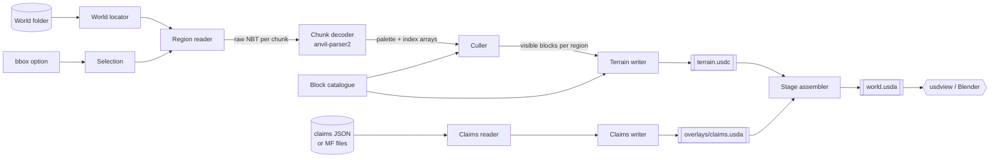

# Architecture

> Status: MVP implemented (milestones M1–M7). This document describes the design as built, including findings made during implementation. Items marked **(verify)** are still unconfirmed; the main one is the `usdview` half of the manual viewer check (AC11), whose Blender half has been performed (see the README's [Viewer checklist](README.md#viewer-checklist-ac11)). Anything marked **(verify)** is a belief that must be confirmed before relying on it.

## Components

| Component | Module | Responsibility |
|---|---|---|
| CLI | `mcusd/cli.py` | Parses arguments, wires the pipeline, reports progress and a summary. |
| World locator | `mcusd/world/layout.py` | Given a world folder and a dimension, finds the region directory. Handles the pre-26.1 layout (`region/`, `DIM-1/region/`, `DIM1/region/`) and the 26.1+ layout (`dimensions/minecraft/<dimension>/region/`). |
| Region reader | `mcusd/world/region.py` | Reads the 8 KiB `.mca` header, locates chunks, decompresses them (gzip, zlib, uncompressed, LZ4 when the optional `lz4` package is installed, and external `c.<x>.<z>.mcc` files for oversized chunks), and returns raw NBT. |
| Chunk decoder | `mcusd/world/chunk.py` | Wraps `anvil-parser2`'s `anvil.Chunk` to turn a chunk's sections into dense `numpy` arrays of palette indices plus a per-chunk palette of block IDs (palettes decoded here; see [World reader](#world-reader)). |
| Selection | `mcusd/select.py` | Converts a block-space bounding box into the set of region files and chunks to read, and clips decoded volumes to the box. |
| Culler | `mcusd/cull.py` | Removes air and blocks whose six neighbours are all opaque full cubes. |
| Block catalogue | `mcusd/blocks.py` | Maps a namespaced block ID to a stable prim-safe name, a display colour and an "opaque full cube" flag. Built-in table plus an override file. |
| Terrain writer | `mcusd/usd/terrain.py` | Writes the base terrain layer: prototype library and one `UsdGeomPointInstancer` per region. |
| Claims reader | `mcusd/overlays/claims_input.py` | Loads the claims input contract (below), including direct adapters for Medieval Factions' own files. |
| Claims writer | `mcusd/usd/claims.py` | Writes the claims overlay layer. |
| Stage assembler | `mcusd/usd/stage.py` | Writes the root layer that sublayers terrain and overlays and sets stage metadata. |

## Data flow



Processing is streamed per region file: a region is read, decoded, culled and written to its own `PointInstancer` before the next region is read, so peak memory is bounded by one region (32 × 32 chunks) plus a one-block halo of its neighbours.

## Output layout

```
out/
├── world.usda              # root layer (ASCII by default; world.usdc with --binary)
├── terrain.usdc            # base terrain layer (always binary crate; large)
└── overlays/
    └── claims.usda         # optional Medieval Factions claims overlay (claims.usdc with --binary)
```

**File format.** Layers default to ASCII `.usda`; the `--binary` flag writes them as crate `.usdc` instead. The one exception is the terrain layer, which is **always** `terrain.usdc` regardless of `--binary`, because it is by far the largest layer and is not meant to be read or diffed by hand. The root layer's `subLayers` paths use whichever extensions were actually written. See [Decisions](#decisions).

### Root layer (`world.usda`)

```usda
#usda 1.0
(
    defaultPrim = "World"
    upAxis = "Y"
    metersPerUnit = 1
    subLayers = [
        @./overlays/claims.usda@,   # strongest first
        @./terrain.usdc@
    ]
    customLayerData = {
        string "mcusd:sourceWorld" = "<world folder name>"
        string "mcusd:dimension" = "minecraft:overworld"
        int[] "mcusd:bbox" = [x1, y1, z1, x2, y2, z2]
        string "mcusd:exporterVersion" = "0.1.0"
    }
)
```

The example shows the default (ASCII) output; with `--binary` the root and overlay layers are `world.usdc` and `overlays/claims.usdc`, and `terrain.usdc` is unchanged.

Overlays are listed before terrain in `subLayers` so their opinions are stronger. Muting a sublayer in `usdview` (or deleting the line) removes that overlay without regenerating anything else.

### Stage / prim layout

```
/World                                   Xform  (kind = assembly)
├── /World/BlockLibrary                  class  (abstract: never rendered)
│   ├── stone                            Mesh   unit cube, displayColor, mcusd:namespacedId
│   ├── grass_block                      Mesh
│   └── ...
├── /World/Terrain                       Xform  (kind = group)
│   ├── r_0_0                            Xform  (kind = group) translate = (0, 0, 0)
│   │   └── Blocks                       PointInstancer  ids, primvars:mcusd:blockId (per instance)
│   │       └── Prototypes               Scope
│   │           ├── stone                Mesh   (inherits </World/BlockLibrary/stone>)
│   │           └── grass_block          Mesh   (inherits </World/BlockLibrary/grass_block>)
│   ├── r_n1_0                           Xform  translate = (-512, 0, 0)
│   └── ...
└── /World/Overlays                      Scope
    └── Claims                           Xform  (defined in overlays/claims.usda)
        ├── faction_<id>                 Xform  primvars:displayColor = faction colour
        │   └── Chunks                   PointInstancer of one translucent 16×H×16 box
        └── ...
```

Design choices:

- **Unit and axes.** One block is one metre (`metersPerUnit = 1`). Minecraft's axes (+X east, +Y up, +Z south) form a right-handed, Y-up system, so they map to USD's right-handed `upAxis = "Y"` with no conversion. A block at integer coordinates `(x, y, z)` occupies the cube `[x, x+1] × [y, y+1] × [z, z+1]`; prototype cubes have their minimum corner at the origin.
- **Region prim names.** Region `(x, z)` is `r_<x>_<z>`, with an `n` prefix for negative coordinates (`r_n1_0` for region −1, 0) because `-` is not valid in a USD prim name. Library meshes and prototypes are named by the [block catalogue](#block-catalogue), and each library mesh records its namespaced ID in a `mcusd:namespacedId` string attribute, which the prototypes inherit.
- **One `PointInstancer` per region file.** Regions give a natural unit for streaming the export, for future payloads (load-on-demand) and for visibility toggling, and keep each instancer's arrays to a manageable size.
- **Region-local positions.** Each region's `Xform` carries a `translate` to the region's block origin, and instance `positions` are region-local (0–511 on X and Z). Instance positions are `point3f` (32-bit float), which represents integers exactly only up to 2²⁴; world coordinates can reach ±30,000,000, so storing absolute positions would lose precision far from spawn. The `translate` op is double precision.
- **Shared prototypes via a `class` prim.** `/World/BlockLibrary` is an abstract `class` prim, so its meshes are never drawn at the origin. Each instancer's `Prototypes` scope holds lightweight prims that `inherit` the library entry, keeping a single source of truth for geometry and colour while following the convention that prototypes live beneath the instancer. Through the USD API (milestone M5) the prototypes compose as `Mesh` prims carrying the library's points and colour, and the abstract library is skipped by default traversal. Blender 5.2.2 renders the inherited prototype meshes as the library's cubes (checked 2026-10-17; see the README's [Viewer checklist](README.md#viewer-checklist-ac11)). **(verify)** that `usdview` renders them too; it is not part of the `usd-core` wheel, so this remains on the manual viewer checklist (AC11). The fallback is to author each prototype as a full `Mesh` under each instancer (geometry is 8 points, so duplication is cheap).
- **Per-instance block IDs from the start.** Every terrain `PointInstancer` authors, alongside `protoIndices` and `positions`, two per-instance arrays of the same length (see [Decisions](#decisions)):
  - `primvars:mcusd:blockId` — `int[]`, interpolation `vertex` (one value per instance), indexing into a layer-wide block-ID table stored as a `string[]` attribute `mcusd:blockIds` on `/World/BlockLibrary` (namespaced IDs such as `minecraft:stone`). Unlike `protoIndices`, which index each instancer's own `Prototypes` and so differ between regions, this ID means the same block type in every region, so an overlay can select, recolour or hide one block type across the whole stage.
  - `ids` — `int64[]`, a stable per-instance identifier derived from the block's region-local position (`(y − ymin) × 512 × 512 + z × 512 + x`, with region-local `x`, `z` in 0–511 and `ymin` the dimension's minimum block Y, −64 for the overworld; unique within an instancer), so a later overlay layer can cut terrain away by authoring `invisibleIds` on a region's instancer, or override individual instances, without regenerating terrain.

  **File-size tradeoff:** this adds about 12 bytes per instance (4 for `blockId`, 8 for `ids`) before crate compression, on top of about 16 bytes for `positions` (12) and `protoIndices` (4) — up to roughly 75 % more per-instance data in `terrain.usdc` before compression. It is accepted so that overlays can cut away and recolour terrain without re-exporting. Measured after crate compression (milestone M7, by re-exporting the same layer without the two arrays), the actual cost is about 4 % of `terrain.usdc` on the fixture worlds and 7.5 % on a 256 × 256-block export; see the README's *Measured performance*.
- **`displayColor` instead of materials.** MVP prototypes carry `primvars:displayColor`; no textures are produced (see [non-goals](CONCEPT.md#non-goals)).
- **Binary terrain, ASCII everything else by default.** `terrain.usdc` always uses the crate format for size and load speed; the root and overlay layers default to `.usda` so they can be read and diffed, and `--binary` switches them to `.usdc`.

## Key USD APIs (`pxr`, from `usd-core`)

| API | Use |
|---|---|
| `Sdf.Layer.CreateNew`, `Usd.Stage.Open(layer)` / `Usd.Stage.CreateNew` | Create each layer independently; each writer owns one layer. |
| `Sdf.Layer.subLayerPaths`, `Sdf.Layer.customLayerData` | Root layer composition and provenance metadata. |
| `UsdGeom.SetStageUpAxis`, `UsdGeom.SetStageMetersPerUnit`, `Usd.Stage.SetDefaultPrim` | Stage metadata. |
| `Usd.Stage.CreateClassPrim` | Abstract `/World/BlockLibrary`. |
| `Usd.Prim.GetInherits().AddInherit` | Prototype prims inheriting the library entry. |
| `UsdGeom.Mesh.Define`, `CreatePointsAttr`, `CreateFaceVertexCountsAttr`, `CreateFaceVertexIndicesAttr`, `CreateExtentAttr`, `CreateDisplayColorPrimvar` | Unit-cube prototypes and claim boxes. |
| `UsdGeom.PointInstancer.Define`, `CreatePrototypesRel`, `CreateProtoIndicesAttr`, `CreatePositionsAttr`, `CreateExtentAttr`, `CreateIdsAttr` | Per-region block instancing, including per-instance `ids`. |
| `UsdGeom.PrimvarsAPI(prim).CreatePrimvar("mcusd:blockId", Sdf.ValueTypeNames.IntArray, UsdGeom.Tokens.vertex)` | Per-instance block-ID primvar on each terrain instancer. |
| `Vt.Vec3fArray.FromNumpy`, `Vt.IntArray.FromNumpy`, `Vt.Int64Array.FromNumpy` | Hand `numpy` arrays to USD without a Python-level loop. Available in `usd-core` 26.8 and used for every per-instance array (M5); whether the hand-off is zero-copy has not been measured. |
| `UsdGeom.Xformable.AddTranslateOp(UsdGeom.XformOp.PrecisionDouble)` | Region and claim-box placement. |
| `Kind.Tokens`, `Usd.ModelAPI.SetKind` | `assembly` / `group` kinds so tools treat the hierarchy sensibly. |

## World reader

`anvil-parser2` (MIT) is the chosen chunk decoder; see the [comparison in CONCEPT.md](CONCEPT.md#world-reading-library-choice). Because its `Region.chunk_data` only handles zlib-compressed chunks ([`anvil/region.py` L71-L81 at `91a7eda`](https://github.com/0xTiger/anvil-parser2/blob/91a7eda55f0fb55a948d1072896430c29d906809/anvil/region.py#L71-L81)), this project implements the region **container** itself and passes the decompressed NBT to `anvil.Chunk(nbt_data)` ([constructor](https://github.com/0xTiger/anvil-parser2/blob/91a7eda55f0fb55a948d1072896430c29d906809/anvil/chunk.py#L79-L94)).

Region container rules implemented by `mcusd/world/region.py`, per the [Region file format](https://minecraft.wiki/w/Region_file_format) article:

| Compression byte | Meaning | MVP handling |
|---|---|---|
| 1 | GZip | `gzip` (stdlib) |
| 2 | Zlib (what the official game writes by default) | `zlib` (stdlib) |
| 3 | Uncompressed | pass-through |
| 4 | LZ4 (added in snapshot 24w04a; enabled via `server.properties`) | optional extra `lz4`; clear error if absent. The payload is an lz4-java `LZ4BlockOutputStream` stream (`LZ4Block` magic, per-block token, little-endian lengths, XXH32 checksum), not the standard LZ4 frame format — confirmed against a region written by a vanilla 1.21.11 server with `region-file-compression=lz4`. |
| 127 | Custom (third-party servers) | clear "unsupported" error naming the chunk |
| +128 | Data stored externally in `c.<x>.<z>.mcc` | read the external file, then apply the base scheme |

`mcusd/world/chunk.py` uses `anvil.Chunk` for the chunk envelope (`DataVersion`, `xPos`/`zPos`, the `sections` list) but decodes palettes and packed block-state indices itself, with vectorised `numpy` shifts instead of `anvil`'s per-block loop. Findings from worlds saved by vanilla 1.21.11 (DataVersion 4671) and 26.3 (DataVersion 5023) servers:

- **26.x palette encoding changed.** 1.21.x writes each `block_states.palette` entry as a `{Name, Properties}` compound. 26.3 writes a property-less entry as a bare string (`"minecraft:stone"`) and an entry with properties as a compound with lowercase `id`/`properties` keys; a list mixing the two wraps each string in a compound under an empty-named tag. `anvil.Chunk.get_palette` understands only the 1.21.x shape (it raises `TypeError` on 26.3 chunks), so the decoder handles all three. The packed `data` long array is unchanged.
- **Importing `anvil` patches `nbt`.** `anvil-parser2` replaces `nbt.TAG_Long_Array`'s format with an unsigned one on import (`anvil/empty_section.py`), so long arrays parse as unsigned; the decoder accepts either signedness.
- Only the 1.18+ chunk format (DataVersion ≥ 2844, 21w43a) is supported; older chunks raise a clear error.
- Chunks whose `Status` is not `minecraft:full` (generation unfinished, typically at the edge of explored terrain) are treated as not generated, matching what the game shows.
- The block-Y range is fixed per vanilla dimension in `mcusd/world/layout.py` (overworld −64..319, Nether and End 0..255); sections outside it (such as the lighting-only sections at section Y −5 and 20) are ignored, and datapack dimensions with other heights are out of scope. `anvil`'s own fixed section range of −4..19 ([`chunk.py` L50-L54](https://github.com/0xTiger/anvil-parser2/blob/91a7eda55f0fb55a948d1072896430c29d906809/anvil/chunk.py#L50-L54)) is not relied on.
- The `nbt` 1.5.1 parser behind `anvil.Chunk` is pure Python; decoding speed is a measured risk (see [Performance](#performance-considerations)).

The 26.1+ `dimensions/minecraft/<dimension>/region/` layout was confirmed on the 26.3 world. Compatibility with real 1.21.x and 26.x worlds remains an explicit MVP acceptance criterion (AC10) rather than an assumption.

### Block catalogue

`mcusd/blocks.py` resolves each namespaced block ID to:

- **A prim name.** `minecraft:<path>` with a `[a-z][a-z0-9_]*` path (every vanilla block) maps to the bare path (`grass_block`). Any other ID is written as `_` followed by its UTF-8 bytes, keeping `[a-z0-9]` and escaping every other byte as `_` plus two hex digits (`mymod:stone` → `_mymod_3astone`). The escape code is prefix-free and bare names never start with `_`, so names are valid USD identifiers and distinct IDs never share a name.
- **A display colour.** A built-in table of approximate colours chosen by eye (no textures are read), dye-colour and wood-type prefixes, and a few suffix rules; anything else gets a deterministic colour hashed from its ID.
- **An "opaque full cube" flag.** An explicit allow-list plus suffix rules (`_planks`, `_ore`, `_concrete`, `_concrete_powder`, `_wool`, `_terracotta`, `_bricks`, `_log`, `_wood`, `_stem`, `_hyphae`, `_tiles`, `_copper`, with exceptions such as `pumpkin_stem` and `big_dripleaf_stem`); air variants are never opaque and unknown blocks (including every non-`minecraft` namespace) are non-occluding.

An optional JSON override file (`--block-overrides`) maps a block ID to `{"color": "#rrggbb", "opaque": true|false}`, e.g. `{"mymod:marble": {"color": "#e8e4dc", "opaque": true}}`.

A layer-wide `BlockIdTable` gives every block ID one integer (index 0 is `minecraft:air`); it is what M5 stores in `primvars:mcusd:blockId` and `/World/BlockLibrary.mcusd:blockIds`.

### Selection

`mcusd/select.py` maps the inclusive bounding box to regions and chunks with floor division (`x >> 4`, `x >> 9`), clamps Y to the dimension, and streams one dense `uint16` volume per region covering the part of the box inside it plus a one-block halo; region coordinates are generated directly from the box and regions without a region file are skipped, so a very large box over a small world costs nothing extra. Halo cells are filled from neighbouring chunks (decoded through a small LRU cache) only where they lie inside the selection; outside the selection, outside the dimension or not generated they stay air, i.e. non-occluding.

## Claims overlay input contract

### What Medieval Factions actually stores

Inspected at [`Dans-Plugins/Medieval-Factions@56bf9b6`](https://github.com/Dans-Plugins/Medieval-Factions/tree/56bf9b652b6c2780db6663957c5e77e96f3797df):

- **Claims are chunk-granular.** A claim is `(worldId: UUID, x: Int, z: Int, factionId)` where `x`/`z` are **chunk** coordinates — [`src/main/kotlin/com/dansplugins/factionsystem/claim/MfClaimedChunk.kt`](https://github.com/Dans-Plugins/Medieval-Factions/blob/56bf9b652b6c2780db6663957c5e77e96f3797df/src/main/kotlin/com/dansplugins/factionsystem/claim/MfClaimedChunk.kt#L8-L13). The database table has the same columns — [`V1__Initial_version.sql` L71-L78](https://github.com/Dans-Plugins/Medieval-Factions/blob/56bf9b652b6c2780db6663957c5e77e96f3797df/src/main/resources/com/dansplugins/factionsystem/db/migration/V1__Initial_version.sql#L71-L78).
- **Two storage back-ends.** `storage.type` is `'database'` (default) or `'json'`; JSON files live under `storage.json.path`, default `./medieval_factions_data` — [`src/main/resources/config.yml` L3-L6](https://github.com/Dans-Plugins/Medieval-Factions/blob/56bf9b652b6c2780db6663957c5e77e96f3797df/src/main/resources/config.yml#L3-L6).
- **JSON claims file** is `claimed_chunks.json`, a Gson serialisation of `{"claims": [MfClaimedChunk, ...]}` — [`storage/json/JsonMfClaimedChunkRepository.kt` L15-L19](https://github.com/Dans-Plugins/Medieval-Factions/blob/56bf9b652b6c2780db6663957c5e77e96f3797df/src/main/kotlin/com/dansplugins/factionsystem/storage/json/JsonMfClaimedChunkRepository.kt#L15-L19).
- **REST API** (opt-in, `api.enabled: false` by default — [`config.yml` L287-L290](https://github.com/Dans-Plugins/Medieval-Factions/blob/56bf9b652b6c2780db6663957c5e77e96f3797df/src/main/resources/config.yml#L287-L290)) serves `GET /api/claims` returning an array of `Claim {worldId, x, z, factionId}` — [`openapi.yaml` L151-L162, L256-L272](https://github.com/Dans-Plugins/Medieval-Factions/blob/56bf9b652b6c2780db6663957c5e77e96f3797df/src/main/resources/openapi.yaml#L151-L162); serialised by [`api/dto/ClaimDto.kt`](https://github.com/Dans-Plugins/Medieval-Factions/blob/56bf9b652b6c2780db6663957c5e77e96f3797df/src/main/kotlin/com/dansplugins/factionsystem/api/dto/ClaimDto.kt) with all IDs as strings.
- **Faction colour** is a faction *flag* named `color`, a `#rrggbb` string (random by default) — [`faction/flag/MfFlags.kt` L26-L31](https://github.com/Dans-Plugins/Medieval-Factions/blob/56bf9b652b6c2780db6663957c5e77e96f3797df/src/main/kotlin/com/dansplugins/factionsystem/faction/flag/MfFlags.kt#L26-L31). In JSON storage, `factions.json` holds `{"factions": [...]}` where each faction has `id`, `name` and a `flags` map keyed by flag name — [`storage/json/JsonStorageDtos.kt` L78-L85, L125](https://github.com/Dans-Plugins/Medieval-Factions/blob/56bf9b652b6c2780db6663957c5e77e96f3797df/src/main/kotlin/com/dansplugins/factionsystem/storage/json/JsonStorageDtos.kt#L78-L85). The REST `Faction` schema has `id` and `name` but **no colour** — [`openapi.yaml` L190-L213](https://github.com/Dans-Plugins/Medieval-Factions/blob/56bf9b652b6c2780db6663957c5e77e96f3797df/src/main/resources/openapi.yaml#L190-L213).
- **Worlds are identified by UUID**, not by folder name.

### Contract

The exporter accepts one documented file, `claims.json`, whose `claims` entries are field-for-field identical to Medieval Factions' `Claim`/`MfClaimedChunk` shape, so the REST response or JSON-storage file can be dropped in with no transformation:

```json
{
  "format": "mcusd-claims",
  "version": 1,
  "factions": [
    { "id": "1b7f...", "name": "Northreach", "color": "#3366cc" }
  ],
  "claims": [
    { "worldId": "9c2e...", "x": 12, "z": -4, "factionId": "1b7f..." }
  ]
}
```

| Field | Required | Notes |
|---|---|---|
| `format`, `version` | yes | Reject unknown formats; reject `version` > supported. |
| `claims[].worldId` | yes | UUID string. Filtered against `--world-uuid`. |
| `claims[].x`, `claims[].z` | yes | **Chunk** coordinates (block = chunk × 16). |
| `claims[].factionId` | yes | String; must match a `factions[].id` or is drawn with a fallback colour and a warning. |
| `factions` | no | Optional; without it, names default to the ID and colours are derived deterministically from the ID. |
| `factions[].color` | no | `#rrggbb`. |

Accepted inputs (all normalised to the contract above by `claims_input.py`):

1. A native `claims.json` as above.
2. A bare JSON array of `Claim` objects (the `GET /api/claims` response saved to a file).
3. A Medieval Factions JSON-storage directory: `claimed_chunks.json` + `factions.json` (colour read from `flags.color`).

Users on the default database back-end can either enable MF's read API and save `/api/claims`, or export to the contract with a SQL query; neither is automated in the MVP, and both are to be documented in the user guide planned for the first release.

### World identity

Claims carry a world UUID; a world folder does not obviously carry it to an offline tool. The MVP requires `--world-uuid <uuid>` whenever the claims input contains more than one distinct `worldId`, and otherwise uses the single world present. Auto-detection from files in the world folder is an [open question](#open-questions).

### Claims overlay layer

`overlays/claims.usda` (`overlays/claims.usdc` with `--binary`) defines `/World/Overlays/Claims`. Per faction: one `Xform` named `faction_<id>` (the ID escaped injectively: `[A-Za-z0-9]` kept, other bytes written as `_` plus two hex digits), with `mcusd:factionId` and `mcusd:factionName` in `customData` and the faction colour as a constant `primvars:displayColor`, and under it one `Chunks` `PointInstancer`. Its single prototype is a translucent 16 × H × 16 box (`displayOpacity` 0.35; the colour is also authored on the box so viewers that ignore inherited primvars still show it) where H spans the export's Y range, with one instance per claimed chunk whose minimum corner is at block `(16x, ymin, 16z)`. Box positions are absolute `point3f` values; they are multiples of 16, which 32-bit floats represent exactly up to 2²⁸, beyond the world border. Only claims whose chunk overlaps the export box in X/Z are written, and duplicate claims are merged. Merging adjacent chunks into larger boxes (as Bluemap_MedievalFactions merges them into polygons) is a post-MVP optimisation.

Reader notes (`mcusd/overlays/claims_input.py`): a `claimed_chunks.json` file on its own is accepted as well as the directory; `factions.json` is optional (without it, names and colours derive from IDs, with a warning); a `factionId` or `worldId` given as a `{"value": ...}` object is unwrapped, in case Gson ever serialises the value class that way (see [open question 4](#open-questions)); and `worldId` must parse as a UUID and is compared in canonical lowercase form.

## Culling

For each region, decoded block IDs are placed into a dense array with a one-block halo taken from neighbouring chunks (read lazily; a neighbour outside the selection or not yet generated counts as non-occluding). A block is **hidden** if it is an opaque full cube and all six face-neighbours are opaque full cubes. This is computed with six shifted `numpy` boolean comparisons — no Python-level per-block loop — in slabs of 64 Y layers so temporary boolean arrays stay small. Air (`minecraft:air`, `cave_air`, `void_air`) is always dropped. `mcusd/cull.py` returns, per region, the visible blocks' absolute positions and layer-wide block IDs plus the culled and air counts that the CLI summary reports. Measured on a fresh 26.3 world, culling the whole of region `r.0.0` (Y −64..319) took about 1 s with a peak resident size of about 360 MB, which includes the 200 MB `uint16` region volume.

"Opaque full cube" comes from the block catalogue: an explicit allow-list plus suffix rules (e.g. `_planks`, `_ore`, `_concrete`); **unknown blocks are treated as non-occluding**, so mistakes keep extra blocks rather than opening holes. Per-face culling (dropping individual faces rather than whole blocks) is post-MVP.

## Dependencies

| Package | Version (pin at MVP start) | Licence | Why |
|---|---|---|---|
| Python | ≥ 3.12 | — | `numpy` 2.5.x requires ≥ 3.12; `usd-core` 26.8 supports < 3.15. |
| [`usd-core`](https://pypi.org/project/usd-core/) | 26.8 (released 2026-07-20) | `LicenseRef-TOST-1.0` per PyPI metadata | Official OpenUSD Python bindings. |
| [`anvil-parser2`](https://pypi.org/project/anvil-parser2/) | 0.10.6 | MIT | Chunk/palette decoding. Pulls in `nbt` 1.5.1 (MIT) and `frozendict` (LGPL-3.0 per its PyPI classifiers). |
| [`numpy`](https://pypi.org/project/numpy/) | ≥ 2.5, < 3 (2.5.4 current) | BSD-3-Clause (plus bundled-component licences per PyPI) | Dense volumes, culling, array hand-off to USD. |
| [`lz4`](https://pypi.org/project/lz4/) | 4.4.5 (optional extra `[lz4]`) | BSD (PyPI classifier) | LZ4-compressed region chunks. |
| [`pytest`](https://pypi.org/project/pytest/) | 9.1.1 (dev) | MIT | Tests. |

No dependency on Medieval Factions code; the coupling is the JSON shape documented above.

**Licence note — `frozendict` (LGPL-3.0).** `frozendict` arrives transitively through `anvil-parser2`. It is accepted as an ordinary pip-installed dependency of this MIT-licensed project: it is installed as a separate package, used unmodified, and neither vendored, copied nor bundled into this repository or any artifact it publishes. If a future change would vendor, modify or bundle it (for example a frozen single-file executable), the licence question must be reopened. See [Decisions](#decisions).

## Testing strategy

- **Unit tests** (`pytest`): region header parsing and every compression scheme (synthetic region files built in-test, including an external `.mcc` chunk); world-layout resolution for pre-26.1 and 26.1+ trees; bounding-box → chunk selection, including negative coordinates; culling on hand-built volumes (solid cube → only shell survives; cave pocket → walls survive; selection edge exposed); claims-input normalisation for all three input shapes, including mismatched `factionId` and multi-world input.
- **USD structure tests**: open the produced stage with `Usd.Stage.Open` and assert prim paths, kinds, `upAxis`, `metersPerUnit`, sublayer order, prototype count, `len(protoIndices) == len(positions)`, every proto index in range, and that the composed `/World/Overlays/Claims` disappears when the overlay layer is muted (`stage.MuteLayer`).
- **Golden fixture worlds**: tiny fresh worlds generated by throwaway, unmodified vanilla servers, committed under `tests/fixtures/` (a few chunks each), exported end-to-end in CI with known block counts at known coordinates. They are produced by the [fixture recipe](#fixture-world-recipe) below; see [Decisions](#decisions).
- **Viewer smoke tests** (manual, documented checklist): `usdview world.usda` opens with terrain and overlay visible; overlay mutes cleanly; Blender's USD importer loads the stage. Blender's manual (5.2 LTS) states that `UsdGeomPointInstancer` prims "are imported into Blender as Point Clouds using a Geometry Nodes Modifier and the Instance on Points Node" ([Blender manual: USD](https://docs.blender.org/manual/en/latest/files/import_export/usd.html)).
- **CI**: GitHub Actions on Linux, Python 3.12 and 3.14: a plain `pip install .` into a fresh virtualenv followed by `mc-usd-export --help` (AC1), then `pip install .[lz4,dev]` and `pytest`. The same workflow then runs **Strata previews**, which exports both fixture worlds with `examples/claims.json` and renders them headless with `scripts/render_strata_preview.py` (Mesa's llvmpipe, no GPU), uploading the images as the `strata-previews` artifact; it fails on a renderer error or a blank image, never on pixel differences. A second workflow, `.github/workflows/usd-asset-gate.yml`, exports the two fixture worlds with `examples/claims.json` (both as `.usda` and, for 26.3, with `--binary`) and runs [usd-asset-gate](https://github.com/Preponderous-Software/usd-asset-gate), pinned to a commit, over the output: OpenUSD's validators plus the rules in `.usd-asset-gate.yml` (`metersPerUnit = 1`, `upAxis = Y`, files under 10 MB), failing on any warning. `usdview` is not part of `usd-core`, so viewer checks stay manual.

### Fixture world recipe

Fixtures are generated, never copied from a played world, so they contain no player data and anyone can regenerate them. The recipe is the script `scripts/make_fixtures.py`, which writes `tests/fixtures/RECIPE.md` (what was run: versions, `server.jar` hashes, seeds, Java) and `tests/fixtures/fixtures.json` (the same plus the recorded counts). The committed fixtures are vanilla **1.21.11** (seed `8675309`, pre-26.1 layout) and **26.3** (seed `42`, 26.1+ layout). World generation turned out not to be bit-for-bit reproducible between runs: decoration near the force-loaded chunks can differ slightly, so regenerating may change the recorded counts, and `fixtures.json` is always rewritten together with the worlds.

| Parameter | Value |
|---|---|
| Server | Official vanilla `server.jar`, unmodified, one per fixture, run in a throwaway temporary directory and deleted afterwards. |
| Versions | Exactly one pinned 1.21.x release (pre-26.1 layout) and exactly one pinned 26.x release (26.1+ `dimensions/` layout). The exact version strings and the `server.jar` SHA-256 are recorded in `RECIPE.md` when the fixtures are first generated and changed only by regenerating. |
| Seed | A fixed `level-seed` per fixture, recorded in `RECIPE.md`; `level-type=minecraft:normal`, `generate-structures=false` so the terrain is determined by seed and version alone. |
| Chunks kept | The four chunks around the origin, chunk X and Z in {−1, 0} (blocks −16..15 on X and Z). They span four region files (`r.-1.-1`, `r.-1.0`, `r.0.-1`, `r.0.0`), so negative coordinates and region boundaries are both exercised. They are force-loaded (`/forceload add -16 -16 15 15`), saved (`/save-all flush`) and the server is stopped. |
| Dimensions | Overworld only by default; the Nether and End locator cases use synthetic layouts in unit tests. |
| Trimming | Every other chunk is dropped by rewriting the four region files to contain only the kept chunks (default zlib compression). Only those region files and `level.dat` are committed. |
| Player data | Never committed: no player ever joins, and `playerdata/`, `stats/`, `advancements/`, `usercache.json`, `ops.json`, `whitelist.json`, logs and any other server files are discarded with the temporary directory. |
| Recorded counts | `RECIPE.md` (or a JSON file beside it) records total and per-region culled block counts for a fixed bbox, plus block IDs at a handful of known coordinates, which the end-to-end tests assert (AC10). |

Running a server requires accepting the Minecraft EULA (`eula=true`) on the machine that generates fixtures; that is a manual step for whoever regenerates them, not something CI does. CI only reads the committed fixtures.

## Performance considerations

- **Memory:** streaming per region bounds peak memory; a region volume at 512 × 384 × 512 with `uint16` palette indices is ~200 MB, so the MVP processes one region at a time and culls it in 64-layer Y slabs. Measured: a 256 × 256-block, full-height export (4 regions, about 1.07 million visible blocks) peaked at about 245 MB resident.
- **Decode speed:** the pure-Python `nbt` library behind `anvil-parser2` was expected to be the bottleneck. In practice the whole pipeline scanned about 16 million blocks per second on a 256-chunk export (README, *Measured performance*); replacing the NBT layer is post-MVP.
- **Array hand-off:** all positions/indices are built as `numpy` arrays and passed to USD in one call per attribute.
- **Terrain layer memory:** an `Sdf.Layer` keeps every authored value in memory until it is saved, which would make memory grow with the whole export. `TerrainWriter` therefore saves `terrain.usdc` after each region and reloads it. Saving a crate layer appends the new data, and reloading turns the values into lazy, file-backed ones. In a measurement with 8 synthetic regions of 3 million instances each, resident memory stayed at about 137 MB with this, against 785 MB and growing without it, and the final file was identical in size.
- **File size:** crate (`.usdc`) for terrain, always; culling typically removes most underground solid blocks. Per-instance `ids` and `primvars:mcusd:blockId` add about 12 bytes per instance before compression (see [Stage / prim layout](#stage--prim-layout)). Target: a 512 × 512 surface export loads in `usdview` interactively on a typical laptop (measured, not promised).
- **Parallelism:** regions are independent; a process pool over regions is a straightforward post-MVP speed-up because each region writes its own prim subtree.

## Decisions

Recorded 2026-10-17 by the project owner. Each resolves an item that was previously listed under open questions.

1. **`frozendict` licence (was open question 6).** `frozendict` (LGPL-3.0, pulled in by `anvil-parser2`) is acceptable as an unmodified, separately pip-installed dependency of this MIT project. Recorded under [Dependencies](#dependencies).
2. **Fixture worlds (was open question 2).** Fixtures are tiny fresh worlds generated by throwaway local vanilla servers at fixed seeds and exactly pinned versions (one 1.21.x, one 26.x); only a few chunks are kept, small fixtures are committed and no player data is included. The generation recipe is in [Fixture world recipe](#fixture-world-recipe); producing it is part of M7 and AC10.
3. **Terrain authors per-instance IDs from M5 (was open question 7).** Each terrain `PointInstancer` stores a per-instance block ID (`primvars:mcusd:blockId`) and per-instance `ids`, so later overlays can cut away or recolour terrain without regenerating it. The file-size cost is accepted; see [Stage / prim layout](#stage--prim-layout).
4. **Output format.** Layers default to `.usda` with a `--binary` flag for `.usdc`, except the terrain layer, which is always `terrain.usdc` because it is huge. The root and overlay layers follow the flag. See [Output layout](#output-layout).

## Open questions

1. **World UUID auto-detection.** Bukkit-family servers are commonly understood to keep a world UUID in a `uid.dat` file in the world folder, but this has not been verified against current Spigot/Paper source or a real 26.x server for this plan. Until it is, `--world-uuid` is explicit.
2. **Spigot/Paper folder layout on 26.x.** The 26.1 `dimensions/` layout above is from the vanilla level-format documentation; whether Spigot/Paper servers (which historically split dimensions into separate world folders) adopt it is to be checked against a real server world. (The committed fixtures come from vanilla servers, so they do not answer this.)
3. **Inherited prototypes.** Composition is confirmed through the USD API (M5), and Blender 5.2.2 renders `PointInstancer` prototypes that `inherit` from an abstract `class` prim. Still to confirm: that `usdview` renders them too; otherwise fall back to per-instancer meshes. This is part of the manual viewer checklist (AC11) in the README.
4. **Gson output of `factionId` in `claimed_chunks.json`.** `MfFactionId` is a Kotlin `@JvmInline value class` over `String`, so the field is expected to serialise as a plain string, matching the REST `ClaimDto` — confirm against a real file.
