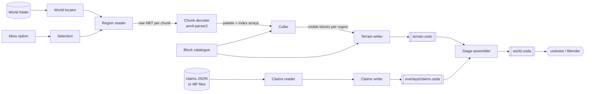

# Architecture

> Status: planning — not yet implemented. This document describes the intended design for the [MVP](MVP.md). Anything marked **(verify)** is a belief that an MVP milestone must confirm before relying on it.

## Components

| Component | Module (planned) | Responsibility |
|---|---|---|
| CLI | `mcusd/cli.py` | Parses arguments, wires the pipeline, reports progress and a summary. |
| World locator | `mcusd/world/layout.py` | Given a world folder and a dimension, finds the region directory. Handles the pre-26.1 layout (`region/`, `DIM-1/region/`, `DIM1/region/`) and the 26.1+ layout (`dimensions/minecraft/<dimension>/region/`). |
| Region reader | `mcusd/world/region.py` | Reads the 8 KiB `.mca` header, locates chunks, decompresses them (gzip, zlib, uncompressed, LZ4 when the optional `lz4` package is installed, and external `c.<x>.<z>.mcc` files for oversized chunks), and returns raw NBT. |
| Chunk decoder | `mcusd/world/chunk.py` | Wraps `anvil-parser2`'s `anvil.Chunk` to turn a chunk's sections into dense `numpy` arrays of palette indices plus a per-chunk palette of block IDs. |
| Selection | `mcusd/select.py` | Converts a block-space bounding box into the set of region files and chunks to read, and clips decoded volumes to the box. |
| Culler | `mcusd/cull.py` | Removes air and blocks whose six neighbours are all opaque full cubes. |
| Block catalogue | `mcusd/blocks.py` | Maps a namespaced block ID to a stable prim-safe name, a display colour and an "opaque full cube" flag. Built-in table plus an override file. |
| Terrain writer | `mcusd/usd/terrain.py` | Writes the base terrain layer: prototype library and one `UsdGeomPointInstancer` per region. |
| Claims reader | `mcusd/overlays/claims_input.py` | Loads the claims input contract (below), including direct adapters for Medieval Factions' own files. |
| Claims writer | `mcusd/usd/claims.py` | Writes the claims overlay layer. |
| Stage assembler | `mcusd/usd/stage.py` | Writes the root layer that sublayers terrain and overlays and sets stage metadata. |

## Data flow



Processing is streamed per region file: a region is read, decoded, culled and written to its own `PointInstancer` before the next region is read, so peak memory is bounded by one region (32 × 32 chunks) plus a one-block halo of its neighbours.

## Output layout

```
out/
├── world.usda              # root layer (ASCII, tiny, human-editable)
├── terrain.usdc            # base terrain layer (binary crate; large)
└── overlays/
    └── claims.usda         # optional Medieval Factions claims overlay
```

### Root layer (`world.usda`)

```usda
#usda 1.0
(
    defaultPrim = "World"
    upAxis = "Y"
    metersPerUnit = 1
    subLayers = [
        @./overlays/claims.usda@,   # strongest first
        @./terrain.usdc@
    ]
    customLayerData = {
        string "mcusd:sourceWorld" = "<world folder name>"
        string "mcusd:dimension" = "minecraft:overworld"
        int[] "mcusd:bbox" = [x1, y1, z1, x2, y2, z2]
        string "mcusd:exporterVersion" = "0.1.0"
    }
)
```

Overlays are listed before terrain in `subLayers` so their opinions are stronger. Muting a sublayer in `usdview` (or deleting the line) removes that overlay without regenerating anything else.

### Stage / prim layout

```
/World                                   Xform  (kind = assembly)
├── /World/BlockLibrary                  class  (abstract: never rendered)
│   ├── stone                            Mesh   unit cube, displayColor
│   ├── grass_block                      Mesh
│   └── ...
├── /World/Terrain                       Xform  (kind = group)
│   ├── r_0_0                            Xform  translate = (0, 0, 0)
│   │   └── Blocks                       PointInstancer
│   │       └── Prototypes               Scope
│   │           ├── stone                Mesh   (inherits </World/BlockLibrary/stone>)
│   │           └── grass_block          Mesh   (inherits </World/BlockLibrary/grass_block>)
│   ├── r_-1_0                           Xform  translate = (-512, 0, 0)
│   └── ...
└── /World/Overlays                      Scope
    └── Claims                           Xform  (defined in overlays/claims.usda)
        ├── faction_<id>                 Xform  primvars:displayColor = faction colour
        │   └── Chunks                   PointInstancer of one translucent 16×H×16 box
        └── ...
```

Design choices:

- **Unit and axes.** One block is one metre (`metersPerUnit = 1`). Minecraft's axes (+X east, +Y up, +Z south) form a right-handed, Y-up system, so they map to USD's right-handed `upAxis = "Y"` with no conversion. A block at integer coordinates `(x, y, z)` occupies the cube `[x, x+1] × [y, y+1] × [z, z+1]`; prototype cubes have their minimum corner at the origin.
- **One `PointInstancer` per region file.** Regions give a natural unit for streaming the export, for future payloads (load-on-demand) and for visibility toggling, and keep each instancer's arrays to a manageable size.
- **Region-local positions.** Each region's `Xform` carries a `translate` to the region's block origin, and instance `positions` are region-local (0–511 on X and Z). Instance positions are `point3f` (32-bit float), which represents integers exactly only up to 2²⁴; world coordinates can reach ±30,000,000, so storing absolute positions would lose precision far from spawn. The `translate` op is double precision.
- **Shared prototypes via a `class` prim.** `/World/BlockLibrary` is an abstract `class` prim, so its meshes are never drawn at the origin. Each instancer's `Prototypes` scope holds lightweight prims that `inherit` the library entry, keeping a single source of truth for geometry and colour while following the convention that prototypes live beneath the instancer. **(verify)** that `usdview` and Blender resolve inherited prototype meshes correctly; fallback is to author each prototype as a full `Mesh` under each instancer (geometry is 8 points, so duplication is cheap).
- **`displayColor` instead of materials.** MVP prototypes carry `primvars:displayColor`; no textures are produced (see [non-goals](CONCEPT.md#non-goals)).
- **Binary terrain, ASCII everything else.** `terrain.usdc` uses the crate format for size and load speed; the root and overlay layers are `.usda` so they can be read and diffed.

## Key USD APIs (`pxr`, from `usd-core`)

| API | Use |
|---|---|
| `Sdf.Layer.CreateNew`, `Usd.Stage.Open(layer)` / `Usd.Stage.CreateNew` | Create each layer independently; each writer owns one layer. |
| `Sdf.Layer.subLayerPaths`, `Sdf.Layer.customLayerData` | Root layer composition and provenance metadata. |
| `UsdGeom.SetStageUpAxis`, `UsdGeom.SetStageMetersPerUnit`, `Usd.Stage.SetDefaultPrim` | Stage metadata. |
| `Usd.Stage.CreateClassPrim` | Abstract `/World/BlockLibrary`. |
| `Usd.Prim.GetInherits().AddInherit` | Prototype prims inheriting the library entry. |
| `UsdGeom.Mesh.Define`, `CreatePointsAttr`, `CreateFaceVertexCountsAttr`, `CreateFaceVertexIndicesAttr`, `CreateExtentAttr`, `CreateDisplayColorPrimvar` | Unit-cube prototypes and claim boxes. |
| `UsdGeom.PointInstancer.Define`, `CreatePrototypesRel`, `CreateProtoIndicesAttr`, `CreatePositionsAttr`, `CreateExtentAttr` | Per-region block instancing. |
| `Vt.Vec3fArray.FromNumpy`, `Vt.IntArray.FromNumpy` | Hand `numpy` arrays to USD without a Python-level loop. **(verify)** availability and zero-copy behaviour in `usd-core` 26.8. |
| `UsdGeom.Xformable.AddTranslateOp(UsdGeom.XformOp.PrecisionDouble)` | Region and claim-box placement. |
| `Kind.Tokens`, `Usd.ModelAPI.SetKind` | `assembly` / `group` kinds so tools treat the hierarchy sensibly. |

## World reader

`anvil-parser2` (MIT) is the chosen chunk decoder; see the [comparison in CONCEPT.md](CONCEPT.md#world-reading-library-choice). Because its `Region.chunk_data` only handles zlib-compressed chunks ([`anvil/region.py` L71-L81 at `91a7eda`](https://github.com/0xTiger/anvil-parser2/blob/91a7eda55f0fb55a948d1072896430c29d906809/anvil/region.py#L71-L81)), this project implements the region **container** itself and passes the decompressed NBT to `anvil.Chunk(nbt_data)` ([constructor](https://github.com/0xTiger/anvil-parser2/blob/91a7eda55f0fb55a948d1072896430c29d906809/anvil/chunk.py#L79-L94)).

Region container rules implemented by `mcusd/world/region.py`, per the [Region file format](https://minecraft.wiki/w/Region_file_format) article:

| Compression byte | Meaning | MVP handling |
|---|---|---|
| 1 | GZip | `gzip` (stdlib) |
| 2 | Zlib (what the official game writes by default) | `zlib` (stdlib) |
| 3 | Uncompressed | pass-through |
| 4 | LZ4 (added in snapshot 24w04a; enabled via `server.properties`) | optional extra `lz4`; clear error if absent |
| 127 | Custom (third-party servers) | clear "unsupported" error naming the chunk |
| +128 | Data stored externally in `c.<x>.<z>.mcc` | read the external file, then apply the base scheme |

Two known limitations of `anvil-parser2` that the MVP accepts and documents:

- Section Y range is fixed at −4..19 (block Y −64..319) for 1.13+ data ([`chunk.py` L50-L54](https://github.com/0xTiger/anvil-parser2/blob/91a7eda55f0fb55a948d1072896430c29d906809/anvil/chunk.py#L50-L54)); datapack dimensions with other heights are out of scope.
- Its NBT dependency (`nbt` 1.5.1) is pure Python; decoding speed is a measured risk (see [Performance](#performance-considerations)).

No 26.x-specific chunk-format changes are known to this plan; compatibility with real 1.21.x and 26.x worlds is an explicit MVP acceptance criterion rather than an assumption.

## Claims overlay input contract

### What Medieval Factions actually stores

Inspected at [`Dans-Plugins/Medieval-Factions@56bf9b6`](https://github.com/Dans-Plugins/Medieval-Factions/tree/56bf9b652b6c2780db6663957c5e77e96f3797df):

- **Claims are chunk-granular.** A claim is `(worldId: UUID, x: Int, z: Int, factionId)` where `x`/`z` are **chunk** coordinates — [`src/main/kotlin/com/dansplugins/factionsystem/claim/MfClaimedChunk.kt`](https://github.com/Dans-Plugins/Medieval-Factions/blob/56bf9b652b6c2780db6663957c5e77e96f3797df/src/main/kotlin/com/dansplugins/factionsystem/claim/MfClaimedChunk.kt#L8-L13). The database table has the same columns — [`V1__Initial_version.sql` L71-L78](https://github.com/Dans-Plugins/Medieval-Factions/blob/56bf9b652b6c2780db6663957c5e77e96f3797df/src/main/resources/com/dansplugins/factionsystem/db/migration/V1__Initial_version.sql#L71-L78).
- **Two storage back-ends.** `storage.type` is `'database'` (default) or `'json'`; JSON files live under `storage.json.path`, default `./medieval_factions_data` — [`src/main/resources/config.yml` L3-L6](https://github.com/Dans-Plugins/Medieval-Factions/blob/56bf9b652b6c2780db6663957c5e77e96f3797df/src/main/resources/config.yml#L3-L6).
- **JSON claims file** is `claimed_chunks.json`, a Gson serialisation of `{"claims": [MfClaimedChunk, ...]}` — [`storage/json/JsonMfClaimedChunkRepository.kt` L15-L19](https://github.com/Dans-Plugins/Medieval-Factions/blob/56bf9b652b6c2780db6663957c5e77e96f3797df/src/main/kotlin/com/dansplugins/factionsystem/storage/json/JsonMfClaimedChunkRepository.kt#L15-L19).
- **REST API** (opt-in, `api.enabled: false` by default — [`config.yml` L287-L290](https://github.com/Dans-Plugins/Medieval-Factions/blob/56bf9b652b6c2780db6663957c5e77e96f3797df/src/main/resources/config.yml#L287-L290)) serves `GET /api/claims` returning an array of `Claim {worldId, x, z, factionId}` — [`openapi.yaml` L151-L162, L256-L272](https://github.com/Dans-Plugins/Medieval-Factions/blob/56bf9b652b6c2780db6663957c5e77e96f3797df/src/main/resources/openapi.yaml#L151-L162); serialised by [`api/dto/ClaimDto.kt`](https://github.com/Dans-Plugins/Medieval-Factions/blob/56bf9b652b6c2780db6663957c5e77e96f3797df/src/main/kotlin/com/dansplugins/factionsystem/api/dto/ClaimDto.kt) with all IDs as strings.
- **Faction colour** is a faction *flag* named `color`, a `#rrggbb` string (random by default) — [`faction/flag/MfFlags.kt` L26-L31](https://github.com/Dans-Plugins/Medieval-Factions/blob/56bf9b652b6c2780db6663957c5e77e96f3797df/src/main/kotlin/com/dansplugins/factionsystem/faction/flag/MfFlags.kt#L26-L31). In JSON storage, `factions.json` holds `{"factions": [...]}` where each faction has `id`, `name` and a `flags` map keyed by flag name — [`storage/json/JsonStorageDtos.kt` L78-L85, L125](https://github.com/Dans-Plugins/Medieval-Factions/blob/56bf9b652b6c2780db6663957c5e77e96f3797df/src/main/kotlin/com/dansplugins/factionsystem/storage/json/JsonStorageDtos.kt#L78-L85). The REST `Faction` schema has `id` and `name` but **no colour** — [`openapi.yaml` L190-L213](https://github.com/Dans-Plugins/Medieval-Factions/blob/56bf9b652b6c2780db6663957c5e77e96f3797df/src/main/resources/openapi.yaml#L190-L213).
- **Worlds are identified by UUID**, not by folder name.

### Contract

The exporter accepts one documented file, `claims.json`, whose `claims` entries are field-for-field identical to Medieval Factions' `Claim`/`MfClaimedChunk` shape, so the REST response or JSON-storage file can be dropped in with no transformation:

```json
{
  "format": "mcusd-claims",
  "version": 1,
  "factions": [
    { "id": "1b7f...", "name": "Northreach", "color": "#3366cc" }
  ],
  "claims": [
    { "worldId": "9c2e...", "x": 12, "z": -4, "factionId": "1b7f..." }
  ]
}
```

| Field | Required | Notes |
|---|---|---|
| `format`, `version` | yes | Reject unknown formats; reject `version` > supported. |
| `claims[].worldId` | yes | UUID string. Filtered against `--world-uuid`. |
| `claims[].x`, `claims[].z` | yes | **Chunk** coordinates (block = chunk × 16). |
| `claims[].factionId` | yes | String; must match a `factions[].id` or is drawn with a fallback colour and a warning. |
| `factions` | no | Optional; without it, names default to the ID and colours are derived deterministically from the ID. |
| `factions[].color` | no | `#rrggbb`. |

Accepted inputs (all normalised to the contract above by `claims_input.py`):

1. A native `claims.json` as above.
2. A bare JSON array of `Claim` objects (the `GET /api/claims` response saved to a file).
3. A Medieval Factions JSON-storage directory: `claimed_chunks.json` + `factions.json` (colour read from `flags.color`).

Users on the default database back-end can either enable MF's read API and save `/api/claims`, or export to the contract with a SQL query; both are documented in the user guide rather than automated in the MVP.

### World identity

Claims carry a world UUID; a world folder does not obviously carry it to an offline tool. The MVP requires `--world-uuid <uuid>` whenever the claims input contains more than one distinct `worldId`, and otherwise uses the single world present. Auto-detection from files in the world folder is an [open question](#open-questions).

### Claims overlay layer

`overlays/claims.usda` defines `/World/Overlays/Claims`. Per faction: one `Xform` with the faction name in `customData`, and one `PointInstancer` whose single prototype is a translucent 16 × H × 16 box (`displayOpacity` 0.35) where H spans the export's Y range, positioned at each claimed chunk. Merging adjacent chunks into larger boxes (as Bluemap_MedievalFactions merges them into polygons) is a post-MVP optimisation.

## Culling

For each region, decoded block IDs are placed into a dense array with a one-block halo taken from neighbouring chunks (read lazily; a neighbour outside the selection or not yet generated counts as non-occluding). A block is **hidden** if it is an opaque full cube and all six face-neighbours are opaque full cubes. This is computed with six shifted `numpy` boolean comparisons — no Python-level per-block loop. Air (`minecraft:air`, `cave_air`, `void_air`) is always dropped.

"Opaque full cube" comes from the block catalogue: an explicit allow-list plus suffix rules (e.g. `_planks`, `_ore`, `_concrete`); **unknown blocks are treated as non-occluding**, so mistakes keep extra blocks rather than opening holes. Per-face culling (dropping individual faces rather than whole blocks) is post-MVP.

## Dependencies

| Package | Version (pin at MVP start) | Licence | Why |
|---|---|---|---|
| Python | ≥ 3.12 | — | `numpy` 2.5.x requires ≥ 3.12; `usd-core` 26.8 supports < 3.15. |
| [`usd-core`](https://pypi.org/project/usd-core/) | 26.8 (released 2026-07-20) | `LicenseRef-TOST-1.0` per PyPI metadata | Official OpenUSD Python bindings. |
| [`anvil-parser2`](https://pypi.org/project/anvil-parser2/) | 0.10.6 | MIT | Chunk/palette decoding. Pulls in `nbt` 1.5.1 (MIT) and `frozendict` (LGPL-3.0 per its PyPI classifiers — used unmodified as a separate package, but noted for licence review). |
| [`numpy`](https://pypi.org/project/numpy/) | ≥ 2.5, < 3 (2.5.4 current) | BSD-3-Clause (plus bundled-component licences per PyPI) | Dense volumes, culling, array hand-off to USD. |
| [`lz4`](https://pypi.org/project/lz4/) | 4.4.5 (optional extra `[lz4]`) | BSD (PyPI classifier) | LZ4-compressed region chunks. |
| [`pytest`](https://pypi.org/project/pytest/) | 9.1.1 (dev) | MIT | Tests. |

No dependency on Medieval Factions code; the coupling is the JSON shape documented above.

## Testing strategy

- **Unit tests** (`pytest`): region header parsing and every compression scheme (synthetic region files built in-test, including an external `.mcc` chunk); world-layout resolution for pre-26.1 and 26.1+ trees; bounding-box → chunk selection, including negative coordinates; culling on hand-built volumes (solid cube → only shell survives; cave pocket → walls survive; selection edge exposed); claims-input normalisation for all three input shapes, including mismatched `factionId` and multi-world input.
- **USD structure tests**: open the produced stage with `Usd.Stage.Open` and assert prim paths, kinds, `upAxis`, `metersPerUnit`, sublayer order, prototype count, `len(protoIndices) == len(positions)`, every proto index in range, and that the composed `/World/Overlays/Claims` disappears when the overlay layer is muted (`stage.MuteLayer`).
- **Golden fixture worlds**: small real worlds saved by an unmodified 1.21.x and 26.x game/server, committed under `tests/fixtures/` (compressed, a few chunks each), exported end-to-end in CI with known block counts at known coordinates. Producing them is an MVP task; see [open questions](#open-questions).
- **Viewer smoke tests** (manual, documented checklist): `usdview world.usda` opens with terrain and overlay visible; overlay mutes cleanly; Blender's USD importer loads the stage. Blender's manual (5.2 LTS) states that `UsdGeomPointInstancer` prims "are imported into Blender as Point Clouds using a Geometry Nodes Modifier and the Instance on Points Node" ([Blender manual: USD](https://docs.blender.org/manual/en/latest/files/import_export/usd.html)).
- **CI**: GitHub Actions on Linux, Python 3.12 and 3.14, `pip install .[lz4,dev]` then `pytest`. `usdview` is not part of `usd-core`, so viewer checks stay manual.

## Performance considerations

- **Memory:** streaming per region bounds peak memory; a region volume at 512 × 384 × 512 with `uint16` palette indices is ~200 MB, so the MVP processes one region at a time in 16-chunk-wide strips if needed **(verify)** by measurement.
- **Decode speed:** the pure-Python `nbt` library behind `anvil-parser2` is the likely bottleneck. The MVP measures blocks/second on the fixture worlds and records it in the README; replacing the NBT layer is post-MVP.
- **Array hand-off:** all positions/indices are built as `numpy` arrays and passed to USD in one call per attribute.
- **File size:** crate (`.usdc`) for terrain; culling typically removes most underground solid blocks. Target: a 512 × 512 surface export loads in `usdview` interactively on a typical laptop (measured, not promised).
- **Parallelism:** regions are independent; a process pool over regions is a straightforward post-MVP speed-up because each region writes its own prim subtree.

## Open questions

1. **World UUID auto-detection.** Bukkit-family servers are commonly understood to keep a world UUID in a `uid.dat` file in the world folder, but this has not been verified against current Spigot/Paper source or a real 26.x server for this plan. Until it is, `--world-uuid` is explicit.
2. **Fixture worlds.** Who produces the small 1.21.x and 26.x fixture worlds, and on which exact game versions? They must be generated by an unmodified game or server and kept tiny.
3. **Spigot/Paper folder layout on 26.x.** The 26.1 `dimensions/` layout above is from the vanilla level-format documentation; whether Spigot/Paper servers (which historically split dimensions into separate world folders) adopt it is to be checked against a real server world.
4. **Inherited prototypes.** Confirm `usdview` and Blender both render `PointInstancer` prototypes that `inherit` from an abstract `class` prim; otherwise fall back to per-instancer meshes.
5. **Gson output of `factionId` in `claimed_chunks.json`.** `MfFactionId` is a Kotlin `@JvmInline value class` over `String`, so the field is expected to serialise as a plain string, matching the REST `ClaimDto` — confirm against a real file.
6. **`frozendict` licence.** `anvil-parser2` depends on `frozendict`, which PyPI lists as LGPL-3.0. Using it unmodified as a separately installed package is normally compatible with an MIT project, but the owner may prefer to drop it if the NBT layer is later replaced.
7. **Should the claims overlay hide terrain?** A future overlay could use `PointInstancer.invisibleIds` (requires authoring `ids` in the terrain layer) for cut-away views; deciding now affects whether terrain authors `ids` in the MVP.
