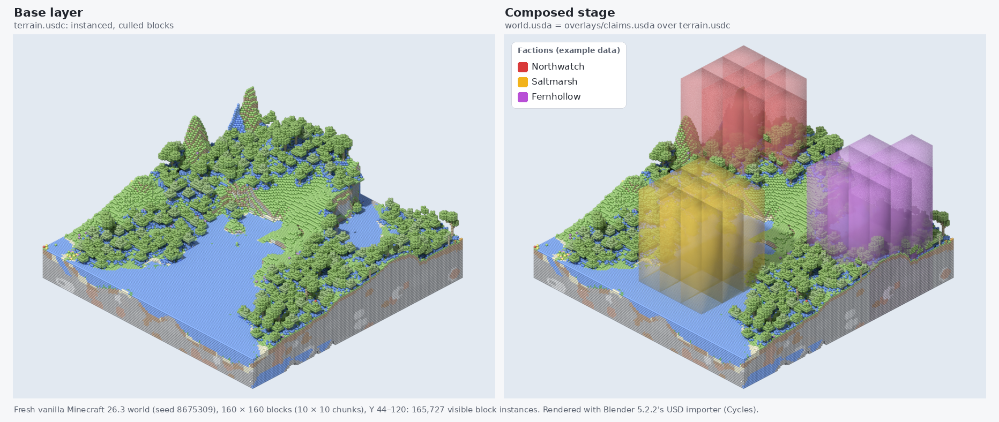
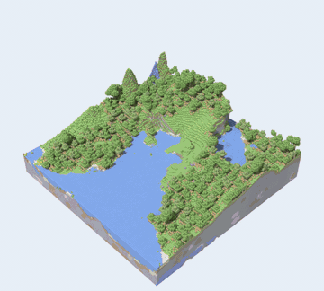
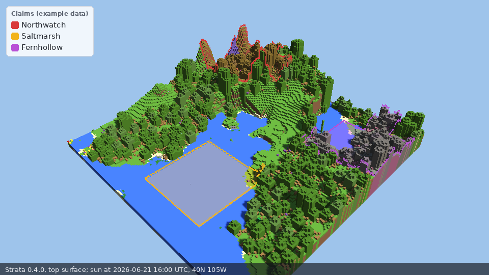
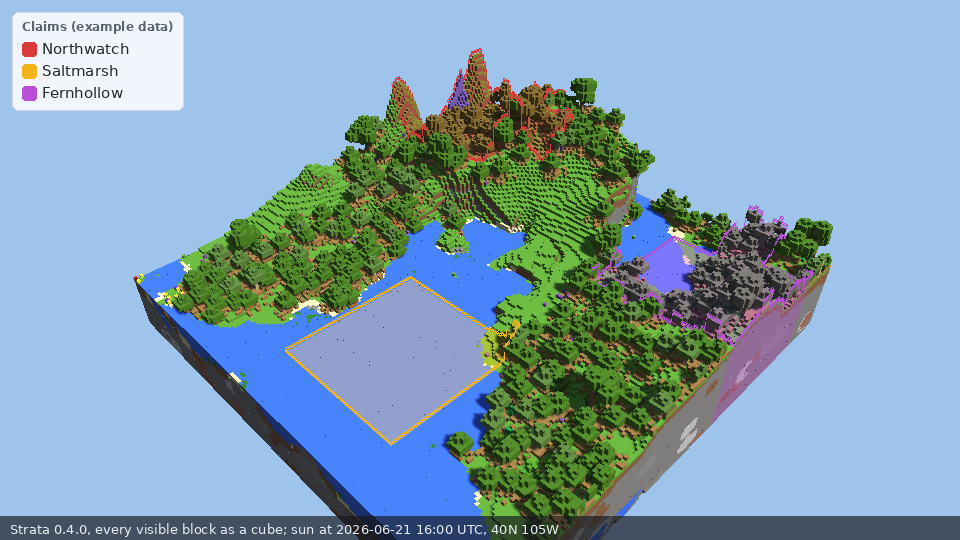
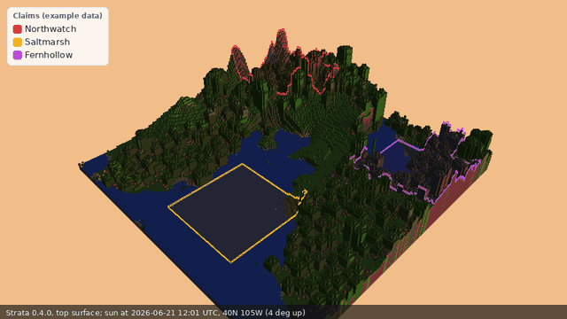

# Minecraft-USD-Exporter

> **Status: MVP implemented (version 0.1.0, not yet released).** All seven MVP milestones are merged. The automated acceptance criteria (AC1–AC10) pass in CI, including end-to-end exports of committed 1.21.11 and 26.3 fixture worlds. The manual viewer check (AC11) has been performed in Blender but **not yet in `usdview`**; see [Viewer checklist](#viewer-checklist-ac11). The package is not published to PyPI.



*The same 160 × 160-block area of a fresh vanilla 26.3 world (seed 8675309), rendered in Blender 5.2.2 from `terrain.usdc` alone (left) and from `world.usda`, where the claims overlay layer is composed over the terrain (right). The factions and claims are example data from [`examples/claims-showcase.json`](examples/claims-showcase.json); see [Preview image](#preview-image) to reproduce it.*

## Description

Minecraft-USD-Exporter is a Python tool that reads Minecraft Java Edition world saves (Anvil region files) and exports a selected area as an [OpenUSD](https://openusd.org) stage.

- Every block type becomes a prototype under a `UsdGeomPointInstancer`, so millions of blocks are stored as compact index and position arrays instead of unique geometry.
- Hidden blocks — those fully enclosed by opaque neighbours — are culled before export.
- Output uses **USD layer composition**: a base terrain layer plus optional overlay layers. The first overlay shows [Medieval Factions](https://github.com/Dans-Plugins/Medieval-Factions) territory claims, read from Medieval Factions' own claim data through a documented JSON contract.
- Results open in `usdview`, Blender, or any USD-capable tool.

Design documents:

- [CONCEPT.md](CONCEPT.md) — problem, audience, non-goals, prior art, and the world-reading library decision.
- [MVP.md](MVP.md) — the smallest end-to-end slice, acceptance criteria and milestones.
- [ARCHITECTURE.md](ARCHITECTURE.md) — components, data flow, USD stage layout, the claims input contract, dependencies, testing and performance.

## Installation

### First Time Installation

1. Install Python 3.12 or newer.
2. Clone this repository: `git clone https://github.com/Dans-Plugins/Minecraft-USD-Exporter.git`
3. Install it into a virtual environment: `pip install .` (add `.[lz4]` to read LZ4-compressed worlds).

### Viewers

- `usdview` comes from a full OpenUSD build: the [`usd-core`](https://pypi.org/project/usd-core/) wheel "does not provide any of the optional plugins or imaging features from the full USD distribution".
- [Blender](https://www.blender.org) can import the output with its built-in USD importer.

## Usage

```bash
mc-usd-export /path/to/world \
  --dimension overworld \
  --bbox -256 -64 -256 255 319 255 \
  --claims claims.json --world-uuid <world-uuid> \
  --out out/
usdview out/world.usda
```

This writes `out/world.usda` (root), `out/terrain.usdc` (instanced, culled blocks) and, with `--claims`, `out/overlays/claims.usda` (Medieval Factions territory). The root and overlay layers are written as ASCII `.usda` by default; add `--binary` to write them as `.usdc`. The terrain layer is always binary (`terrain.usdc`) because it is large.

Try it on a committed fixture world from a checkout:

```bash
mc-usd-export tests/fixtures/world-26.3 --bbox -16 -64 -16 15 319 15 \
  --claims examples/claims.json --out out/
```

| Option | Meaning |
|---|---|
| `WORLD` | World folder (the one containing `level.dat`). Pre-26.1 (`region/`, `DIM-1/`, `DIM1/`) and 26.1+ (`dimensions/minecraft/<dimension>/`) layouts are both read. |
| `--bbox X1 Y1 Z1 X2 Y2 Z2` | Inclusive block-space box; any two opposite corners. Y is clamped to the dimension. Required. |
| `--out DIR` | Output directory. Must not be inside the world folder. Required. |
| `--dimension` | `overworld` (default), `the_nether` or `the_end` (also accepted with a `minecraft:` prefix). |
| `--claims PATH` | Claims input: an `mcusd-claims` JSON file, a saved Medieval Factions `GET /api/claims` array, or a Medieval Factions JSON-storage directory (`claimed_chunks.json` + `factions.json`). See the [contract](ARCHITECTURE.md#claims-overlay-input-contract); [`examples/claims.json`](examples/claims.json) is a sample. Only claims overlapping the box are drawn. |
| `--world-uuid UUID` | Which world's claims to draw; required when the claims cover more than one world. |
| `--block-overrides PATH` | JSON mapping block IDs to `{"color": "#rrggbb", "opaque": true\|false}`. |
| `--binary` | Write the root and overlay layers as `.usdc`. |
| `--summary-json PATH` | Also write the export summary (counts per region, file sizes, timings) as JSON. |
| `-q`, `--quiet` | Print only errors and warnings. |
| `--version` | Print the exporter version and exit. |

Exit status: `0` on success, `2` for invalid input (bad arguments, not a world, unreadable claims or overrides), `1` when world data cannot be read (for example a corrupt region file or a chunk using unsupported custom compression). LZ4-compressed worlds need the `[lz4]` extra.

Always export from a **copy** of a world folder or from a stopped server; the tool only reads, but reading files a running server is writing can give inconsistent results.

### Measured performance

Measured on 2026-10-17 on a Linux machine shared with other workloads (Python 3.12.13, usd-core 26.8). The figures are a single run each, not benchmarks.

| Export | Blocks scanned | Visible instances | Time (pipeline) | `terrain.usdc` | Peak RSS |
|---|---|---|---|---|---|
| `tests/fixtures/world-1.21.11`, 4 chunks, full height | 393,216 | 38,587 | 0.13 s | 506 KB | 137 MB |
| `tests/fixtures/world-26.3`, 4 chunks, full height | 393,216 | 37,203 | 0.11 s | 489 KB | 137 MB |
| Fresh 26.3 world (seed 42), 256 × 256 blocks (256 chunks, 4 regions), full height | 25,165,824 | 1,069,183 | 1.56 s (about 16 M blocks/s) | 14.3 MB | 245 MB |

The per-instance `ids` and `primvars:mcusd:blockId` arrays (see [Decisions](ARCHITECTURE.md#decisions)) cost about 4 % of `terrain.usdc` on the fixtures and 7.5 % on the 256 × 256 export after crate compression. That is far below the up-to-75 % uncompressed estimate, measured by re-exporting the same layer with and without those two arrays. `terrain.usdc` averages about 13 bytes per visible block.

### Viewer checklist (AC11)

*Partly performed.* The Blender checks were done on 2026-10-17 with Blender 5.2.2 (headless, on the `tests/fixtures/world-26.3` export shown above and on the export behind the [preview image](#preview-image)). The `usdview` checks are still owed: `usdview` is not part of the `usd-core` wheel. To perform them, export a fixture with claims as shown above, then:

1. `usdview out/world.usda`: terrain blocks appear as coloured cubes and the four claim boxes appear as translucent coloured columns over them.
2. In usdview's layer stack, mute `overlays/claims.usda`: the claim boxes disappear and the terrain is unchanged.
3. Blender (File → Import → Universal Scene Description) on `out/world.usda`: the stage loads, with terrain imported as instanced point clouds.
4. Confirm the inherited prototypes (`Prototypes/<block>` prims inheriting `/World/BlockLibrary/<block>`) render in both viewers. If either does not, the documented fallback is per-instancer meshes ([ARCHITECTURE.md](ARCHITECTURE.md#stage--prim-layout)).

Record the results and tool versions here. In Blender, each `PointInstancer` imports as a point cloud instanced through geometry nodes; the `Prototypes/<block>` prims, which carry no geometry of their own, render as the cubes inherited from `/World/BlockLibrary`, and the claims sublayer composes without flattening.

| Check | usdview (version) | Blender (version) |
|---|---|---|
| Terrain visible | not yet checked | yes (5.2.2) |
| Claim boxes visible | not yet checked | yes (5.2.2) |
| Muting the overlay hides the boxes | not yet checked | n/a |
| Inherited prototypes render | not yet checked | yes (5.2.2) |

### Preview image

The image at the top of this README is reproducible from a checkout. It needs Blender (5.2.2 was used) and, for the side-by-side composite, Pillow.

1. Generate a throwaway world with the [fixture recipe](ARCHITECTURE.md#fixture-world-recipe) (official vanilla 26.3 `server.jar`, seed `8675309`, no players), force-loading blocks −128..127 on X and Z (`forceload add -128 -128 127 127`; the export uses chunks −8..1). The world itself is not committed.
2. Export the area with the example claims:

   ```bash
   mc-usd-export /path/to/world --bbox -128 44 -128 31 120 31 \
     --claims examples/claims-showcase.json --out out/
   ```

3. Render both layers with the same framing, then compose them:

   ```bash
   blender -b --threads 6 --python scripts/render_preview.py -- out/terrain.usdc terrain.png --frame-from out/world.usda --size 900 680 --samples 64
   blender -b --threads 6 --python scripts/render_preview.py -- out/world.usda world.png --frame-from out/world.usda --size 900 680 --samples 64
   python scripts/compose_preview.py terrain.png world.png examples/claims-showcase.json preview.png
   ```

Blender's USD importer composes the overlay sublayer itself; no flattening is needed. Block colours are the exporter's built-in display colours (`primvars:displayColor`); blocks without a built-in colour get a hashed colour. The still above was rendered before `leaf_litter` was given a built-in colour, which is why some forest floor in it shows as blue.

#### Orbit animation



*One full camera orbit of the same area and example factions, rendered from `world.usda` with `scripts/render_orbit.py` in Blender 5.2.2 (240 frames at 960 × 540, Cycles CPU, 10 samples with denoising, about 7 s per frame on 4 threads). The GIF is cropped and reduced to 8 fps and 360 px wide to keep it small.*

`scripts/render_orbit.py` renders one full camera orbit of an export as numbered PNG frames. The claims overlay is hidden for the first half of the loop, fades in, and fades out again just before the loop restarts. Only the nearest overlay surface along each ray is tinted, so large claims do not turn opaque where rows of chunk boxes stack up. From the same export as above:

```bash
blender -b --threads 4 --python scripts/render_orbit.py -- out/world.usda frames/ \
  --frames 240 --samples 10 --elevation 40 --overlay-strength 1.4
ffmpeg -framerate 24 -i frames/frame_%04d.png -c:v libx264 -pix_fmt yuv420p -crf 26 -movflags +faststart orbit.mp4
```

`--still 0.85` renders a single frame (to `frames/still.png`) instead, for a poster image.

### Headless previews with Strata







*The same export and example factions as the Blender images above (a fresh vanilla 26.3 world, seed 8675309), rendered with `scripts/render_strata_preview.py` and [Strata](https://github.com/Preponderous-Software/strata) 0.4.0 on Mesa's llvmpipe, with no GPU, no window and no Blender. Top: the top surface (the default). Middle: `--full`, every visible block as a cube. Bottom: `--sequence 24`, the sun from just after sunrise to just before sunset on 21 June 2026 at 40° N, 105° W. Each still took about 2.5 s (top surface) and 10 s (`--full`, 163,275 cubes) end to end on a shared 20-thread machine.*

`scripts/render_strata_preview.py` draws an export with Strata's released Linux library through its C ABI (`ctypes`), headless (EGL surfaceless). It reads the USD the exporter wrote, not the exporter's in-memory arrays, so it shows what a user opens. It complements the Blender scripts above, which stay the source of the images at the top of this README; it does **not** replace the viewer check (AC11), because it reads the stage through `usd-core` itself.

- **Top surface (default).** [usd-web](https://github.com/Preponderous-Software/usd-web) reduces `/World/Terrain` to its top surface and greedy-meshes it; each 128 × 128 tile becomes one Strata mesh with sun shadows. Trees read as columns, because a top surface has no overhangs.
- **`--full`.** Every visible block becomes a Strata cube primitive, so caves and the box's cut faces show; about 50 times the frame cost on a software rasteriser.
- **Claims.** When the stage composes `overlays/claims.*`, blocks in claimed chunks are tinted toward the faction colour (by the overlay's opacity, 0.35), each claim's outer edge is traced over the terrain in that colour, and a legend is drawn with Pillow. `--no-claims` and `--no-legend` turn these off.
- **Fixed framing.** The camera looks from a fixed direction (`--azimuth`, `--elevation`) framed on the export's bounds, and the sun is placed for a fixed moment and place (`--sun 2026-06-21T16:00:00Z --lat 40 --lon -105` by default) with Strata's solar position. Two runs on one export frame identically. The sun is a framing choice, not a claim about the world.
- **Sun sequence.** An output ending in `.gif` (or `--sequence N`) renders N frames across the daylight hours of `--sun`'s date and writes an animated GIF.

It needs Linux x86-64, `libEGL.so.1` with a Mesa driver (`apt install libegl1 libegl-mesa0 libgl1-mesa-dri`), usd-web and Pillow. None of these is a dependency of the package, so `pip install .` is unchanged:

```bash
pip install -e . "usd-web @ git+https://github.com/Preponderous-Software/usd-web@03f1cd518b01276da2ecc73435ab2e821c5fba89" pillow
mc-usd-export tests/fixtures/world-26.3 --bbox -16 -64 -16 15 319 15 \
  --claims examples/claims.json --out out/
export LIBGL_ALWAYS_SOFTWARE=1 GALLIUM_DRIVER=llvmpipe   # without a GPU
python scripts/render_strata_preview.py out/world.usda preview.png
python scripts/render_strata_preview.py out/world.usda preview-full.png --full
python scripts/render_strata_preview.py out/world.usda day.gif --sequence 24
```

The Strata library is the release pinned in [`scripts/strata.lock.json`](scripts/strata.lock.json). On first use the script downloads it into `~/.cache/mcusd/strata/<version>/`, checks it against the pinned SHA-256 (copied from the release's `SHA256SUMS`) and deletes it on a mismatch; `--strata PATH` or `MCUSD_STRATA_LIB` uses a local build instead. The script checks Strata's ABI version and every struct it declares against `strata_struct_size()` before drawing. Exit status: `0` written, `1` rendering failed or the image is blank (fewer than 2 % of pixels drawn), `2` bad input, `3` Strata, EGL or Mesa could not be loaded.

The images above were made from the [preview image](#preview-image) export (`--bbox -128 44 -128 31 120 31` with `examples/claims-showcase.json`) with the last three commands applied to that export. CI renders the fixture worlds the same way on every pull request (the **Strata previews** job; images in the `strata-previews` artifact).

### Documentation

- [MVP scope and acceptance criteria](MVP.md)
- [Claims overlay input contract](ARCHITECTURE.md#claims-overlay-input-contract)
- [Output stage layout](ARCHITECTURE.md#output-layout)

A User Guide and a full CLI reference will be added with the first release.

## Support

You can find the support Discord server [here](https://discord.gg/xXtuAQ2).

### Experiencing a bug?

Please fill out a bug report [here](https://github.com/Dans-Plugins/Minecraft-USD-Exporter/issues).

- [Known Bugs](https://github.com/Dans-Plugins/Minecraft-USD-Exporter/issues?q=is%3Aissue+is%3Aopen+label%3Abug)

## Contributing

- The MVP is tracked as issues labelled [`mvp`](https://github.com/Dans-Plugins/Minecraft-USD-Exporter/issues?q=is%3Aissue+label%3Amvp); each maps to a milestone in [MVP.md](MVP.md#milestones).
- See [CONTRIBUTING.md](CONTRIBUTING.md) for the development setup, test command and conventions.

## Testing

The test suite uses `pytest`. After the development install below:

Linux:

    python -m pytest

Windows:

    py -m pytest

If pytest reports all tests passed, the tests have passed. CI runs the same suite on Linux with Python 3.12 and 3.14, and checks stages exported from the fixture worlds with [usd-asset-gate](https://github.com/Preponderous-Software/usd-asset-gate) (see [CONTRIBUTING.md](CONTRIBUTING.md#running-the-tests)).

## Development

This is a command-line Python tool rather than a server plugin, so there is no Docker test server. Development uses a virtual environment (Python 3.12 or newer):

Linux:

    python3 -m venv .venv
    . .venv/bin/activate
    pip install -e ".[lz4,dev]"

Windows:

    py -m venv .venv
    .venv\Scripts\activate
    pip install -e ".[lz4,dev]"

## Authors and Acknowledgement

### Developers

| Name | Main Contributions |
|------|--------------------|
| Daniel McCoy Stephenson | Creator |

Planning documents were drafted with Claude (Anthropic).

## License

This project is licensed under the [MIT License](LICENSE).

See the [LICENSE](LICENSE) file for full details.

## Project Status

MVP implemented: milestones M1–M7 are merged and AC1–AC10 pass in CI; the manual viewer check (AC11) is done in Blender and still owed in `usdview`. See [MVP.md](MVP.md#milestones).
